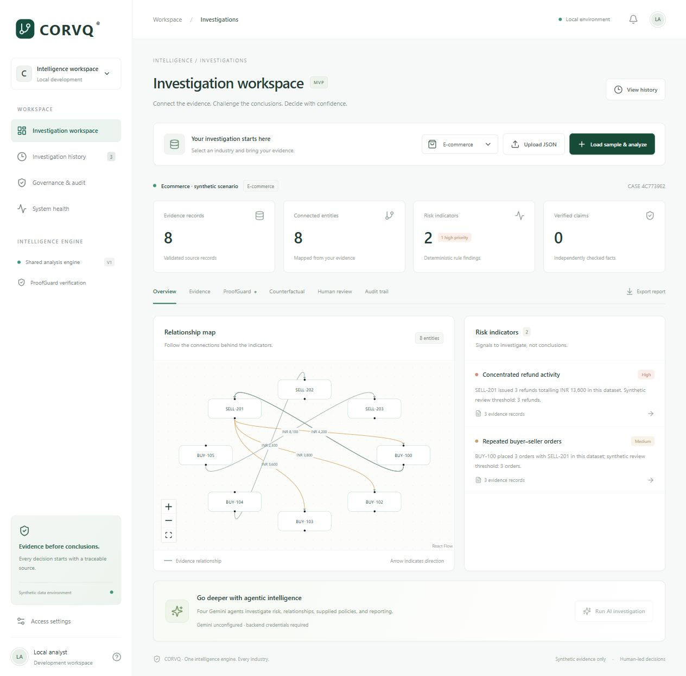

# Verification

Local verification completed on 2026-10-17:

- 17 backend regression tests pass.
- Frontend graph mapping unit test passes.
- Vite production build succeeds.
- Browser: banking sample produces 8 evidence records, 7 entities and 5 risk findings.
- Browser: ProofGuard rejects TX-001 amount 50000 with actual evidence value 145000.
- Browser: removing TX-003 creates a separate 7-record scenario with 3 findings; original remains in history.
- Browser: e-commerce sample produces 8 records, 8 entities and 2 findings (refund cluster and repeated orders).

Live Gemini, cloud deployment and GitHub security workflows have not been executed. CI configuration is supplied but requires a repository remote. Production identity, Firestore and immutable auditing remain future work.

